# AI Plant Doctor

**An AR plant-disease diagnosis and treatment simulator for Android.** Take a photo of a leaf: the app identifies the plant and the
disease, then teaches the disease, its treatment, recovery and prevention on an interactive 3D model of that plant.

Most plant-disease apps stop at a label ("Early blight, 94%"). AI Plant Doctor goes on from there: it shows how the disease spreads,
walks you through treatment step by step, shows that recovery is gradual and partial, and says plainly when the AI is unsure.

**[⬇ Download the APK](https://github.com/anisheda3/plantdoc/releases/latest)** (Android 7.0+, no ARCore needed)

<p>
  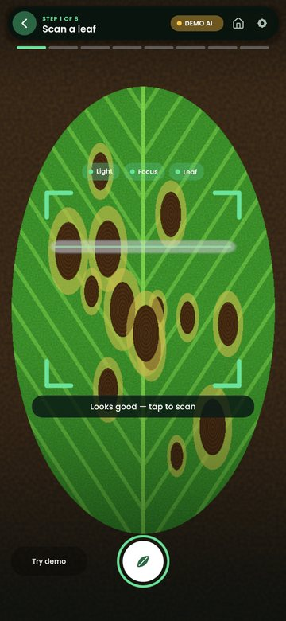
  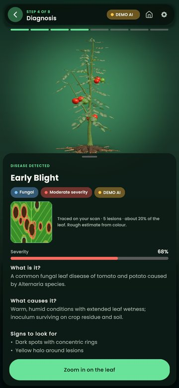
  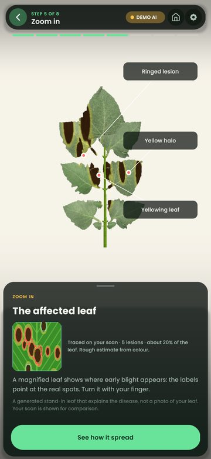
  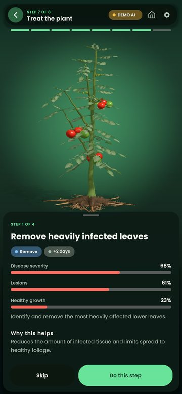
  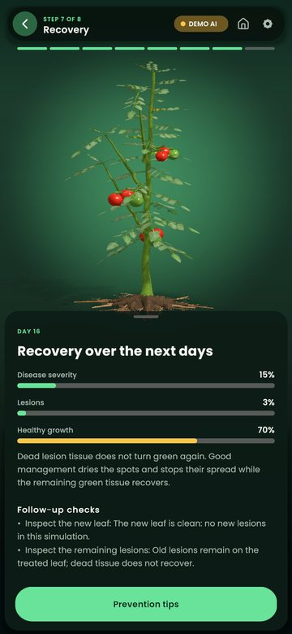
</p>

## Features

- **37 plants, 142 diseases**, covering PlantVillage, PlantSeg, PlantDoc, MangoLeafBD, a sugarcane dataset, chilli datasets and
  every class of the CropScan XR model (278 dataset class names mapped).
- **Real AI**: connects to the [CropScan XR API](https://cropscan-api-ovmb.onrender.com/docs) (BioCLIP ViT-B/16, 69 classes) or to
  the bundled FastAPI server (`server/`). A labelled **Demo AI** runs offline for any plant and disease.
- **A 3D twin for every species**, built from published plant sizes and textured with real leaf photographs; diseases are drawn on
  the leaves, fruit, heads or roots where they actually appear.
- **Guided flow**: scan (with a blur/exposure quality gate) → identify → health check → diagnosis → zoomed leaf with labels on the
  lesions → how it spread → treatment steps → simulated recovery → prevention → report.
- **Honest uncertainty**: confidence is banded; an uncertain result is shown only as a possibility, never as a diagnosis.
- **One content database** (`Database/plant_doctor_content.db`, SQLite) shared by the app and the server.

<p>
  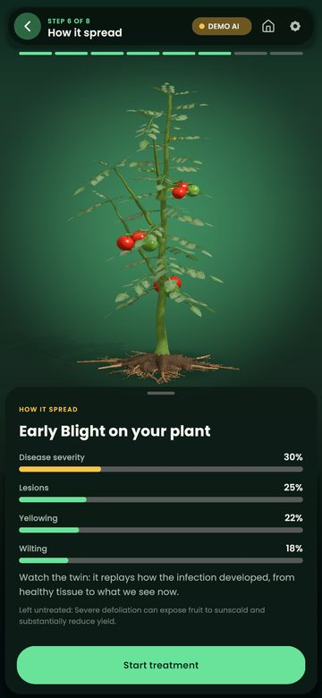
  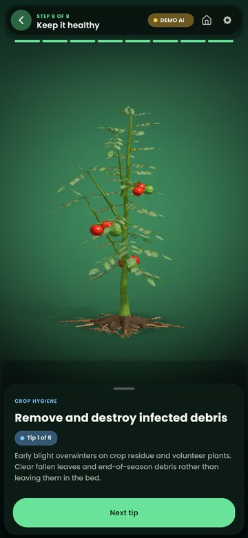
  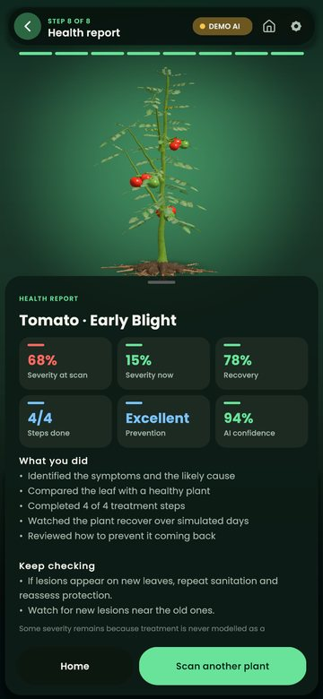
  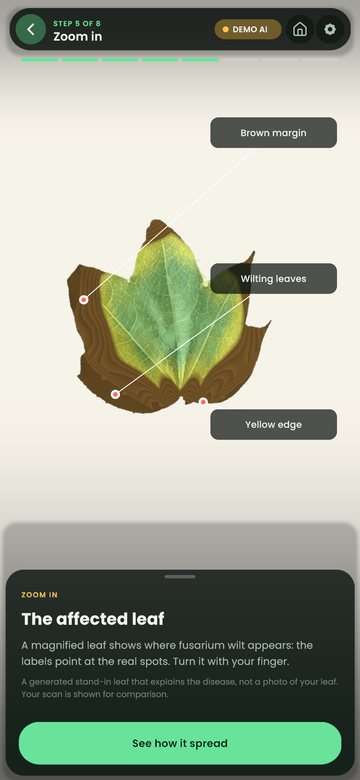
  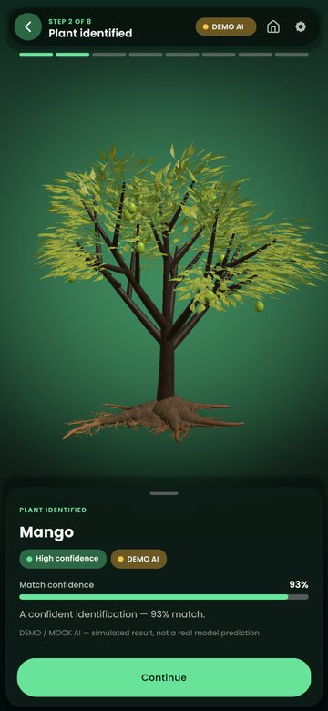
</p>

### Some of the 37 plants

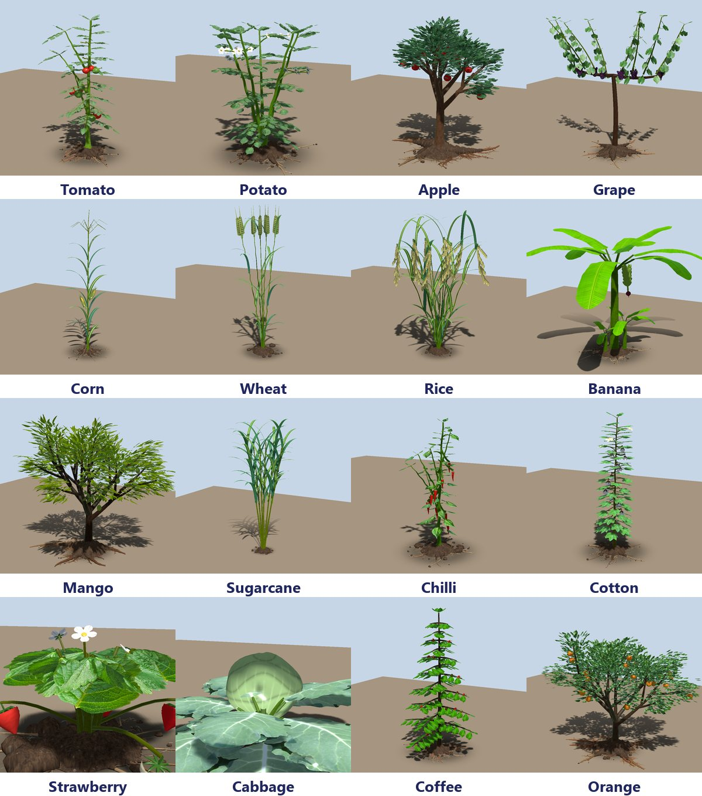

## Using the app

1. Install the APK from [Releases](https://github.com/anisheda3/plantdoc/releases/latest) (allow installs from unknown sources).
2. Open **Settings (gear) → Server AI** and enter `https://cropscan-api-ovmb.onrender.com`, then **Test connection**.
   The free server sleeps when idle, so the first request can take up to a minute.
   Or keep **Demo AI** and pick a plant and condition to explore without a network.
3. Tap **Scan**, fill the frame with one leaf, and follow the steps.

## Architecture

```
Camera / photo ─► quality gate ─► AI service (CropScan | FastAPI | Demo) ─► label map ─► content database
                                                                                 │
                         3D plant twin + zoomed leaf ◄──────────────────────────┘
                         ─► treatment ─► recovery simulation ─► prevention ─► report
```

| Folder | What it is |
|---|---|
| `Assets/Scripts` | Unity C# app: AI clients (`AI/`), flow and state machine (`Core/`), plants and procedural 3D twins (`Plants/`), disease simulation, treatment, UI |
| `Assets/Editor` | Project setup, data builders (every plant and disease is generated from data), build script, plant gallery |
| `Assets/Tests` | EditMode (221) and PlayMode tests |
| `server/` | FastAPI inference server and content API ([server/README.md](server/README.md)) |
| `Database/` | The content database and how to edit it ([Database/README.md](Database/README.md)) |
| `tools/` | Data, asset and evaluation scripts (leaf photos, disease content, label maps) |
| `training/` | Model-training setup |
| `docs/` | Design notes, the decision log, evaluations, credits and screenshots |

## Building from source

- **Unity 2022.3.62f3** with Android Build Support. Open the folder in Unity Hub.
- Generate the plants, diseases, textures and scene: in batch mode
  `-buildTarget Android -executeMethod PlantDoctor.EditorTools.BuildScript.CommandLineSetup`, or in the editor
  **Tools → AI Plant Doctor → Configure Project for Android AR**, then **Build Demo Data**.
- Build: **Tools → AI Plant Doctor → Build Android APK** (or `BuildScript.CommandLineBuild`); output in `Builds/Android/`.
- Tests: `powershell -ExecutionPolicy Bypass -File tools/run-tests.ps1` (add `-Screens` to regenerate `docs/screenshots`).
- Server: see [server/README.md](server/README.md) (`pip install -r server/requirements.txt`, `uvicorn main:app`).

The downloaded datasets and photos in `tools/assets/_cache/` are not in this repository; the scripts in `tools/` download them
again. PlantSeg images are licensed for non-commercial use, so they are used only for evaluation and never shipped.

## Status and limitations

- Tested in the Unity editor and with automated tests; not yet field-tested with farmers on real phones.
- Disease and treatment content is general plant-pathology knowledge and has **not been reviewed by a plant pathologist**.
  Treatment steps deliberately name no pesticide products or doses: follow local registered labels and extension advice.
- The CropScan model reports the disease but not its severity; the simulation then starts at a moderate level and says so.
- Every design decision, with its evidence, is logged in [docs/DECISIONS.md](docs/DECISIONS.md).

## Credits

Leaf and disease photographs are from Wikimedia Commons and PlantVillage (CC0), each credited in
[docs/CREDITS.md](docs/CREDITS.md). Dataset class names from PlantVillage, PlantSeg, PlantDoc, MangoLeafBD and the sugarcane and
chilli leaf datasets. AI model: CropScan XR.

---
B.Tech project · E Anish · Mentor: Dr. Pavan Kumar B N
